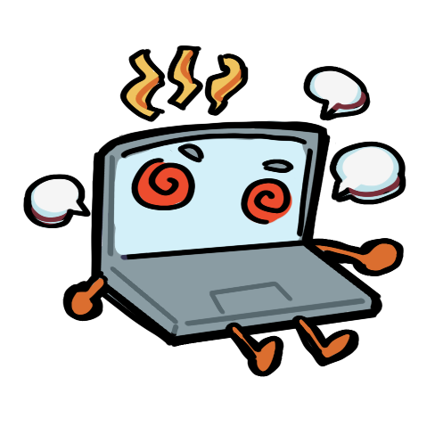
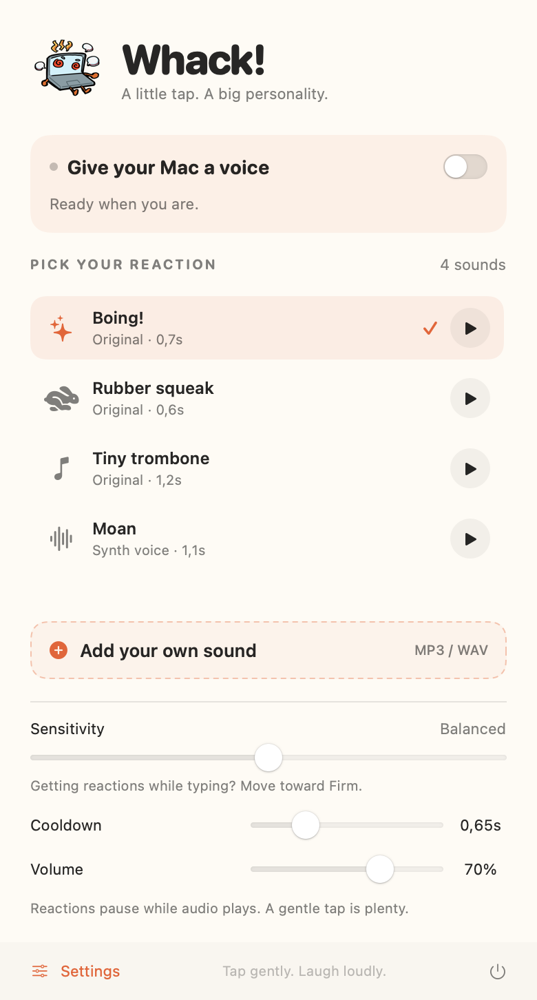

<p align="center">
  
</p>

# Whack!

Give your Mac a voice. Whack is a native macOS menu bar app that plays a funny
sound when you gently tap a compatible MacBook.

**Open → choose a sound → switch on → tap.**

<p align="center">
  
</p>

## What it does

- Four original reactions: Boing!, Rubber squeak, Tiny trombone, and Moan (synth voice).
- Preview and select sounds from a compact menu bar panel.
- Add your own MP3 or WAV through a file picker or drag and drop.
- Rename, replace, and delete imported sounds inside the app.
- Adjust sensitivity, cooldown, and playback volume.
- Remember your sound and settings, with reactions off at each launch.
- Show helpful messages for unavailable sensors and muted audio output.

Whack keeps its own copy of imported sounds, so moving the original file won't
break playback. Everything stays on your Mac: no accounts, analytics, microphone
access, or network service. The app does not monitor your typing.

## Build and run

Requires **macOS 14 or later**, **Swift 6 or later**, and a compatible **Apple
Silicon MacBook** for tap detection. Install Apple's Command Line Tools with
`xcode-select --install` if needed, then check `swift --version`.

```sh
git clone https://github.com/JohanesPeterV/whack.git
cd whack
./scripts/build-app.sh
open dist/Whack.app
```

There are no third-party package dependencies. You can also run `swift run Whack`
during development. The packaged app includes the logo, app icon, and sounds.

This is an early source release. The default build is signed ad hoc for local
development; it is not a Developer ID signed, notarized download.

## Use it

1. Open Whack, then click the hand icon in the menu bar whenever you need the panel.
2. Press a sound's play button to check playback; click its name to select it.
3. Turn on the switch, wait for the listening status, and try a gentle tap.
4. In Settings, move sensitivity toward **Light** if taps are missed, or **Firm**
   if ordinary typing causes reactions.

Use **Add your own sound** to import audio. The menu beside an imported sound
offers Rename, Replace, and Delete. Files must be MP3 or WAV, mono or stereo,
at most 30 seconds long and 25 MB. Deleting a selected import falls back to Boing!.
Your library and settings live in `~/Library/Application Support/Whack/`.

If playback is silent, check the app's volume, macOS output volume, and selected
audio output device. Whack shows a warning when it detects muted or zero-volume
output and never changes system volume automatically.

## Compatibility

Tap detection uses an undocumented Apple SPU accelerometer interface. It has been
verified on **Mac16,5 running macOS 26.5.1**, including sensor access without
administrator privileges. Support for other models and OS versions is unverified;
macOS 14 is the build target, not a claim that every Mac running it has this sensor.

If a sensor is missing or inaccessible, Whack reports the problem and sound
previews and library management remain available. There is no privileged helper.
Sensitivity may need tuning for your hardware, desk, and typing style. Gentle-tap
and typing behavior still needs broader real-world testing.

The sensor stops when reactions are disabled, the Mac sleeps, or the app quits.
After wake it resumes only if reactions were enabled. Playback and a short tail
suppress reactions to the Mac's own speakers.

## Development and testing

```sh
# Library, audio validation, persistence, and tap-detector regression checks
swift run whack-tests

# Actual macOS UI controls, using a temporary, isolated sound library
swift build --product Whack
swift run whack-ui-tests "$(swift build --show-bin-path)/Whack" \
  "$PWD/Tests/WhackCoreTests/Fixtures/boing.mp3"

# Hardware diagnostics on a compatible Mac
swift run whack-check
swift run whack-check --interactive --audio

# Verify the packaged resources and sensor lifecycle
dist/Whack.app/Contents/MacOS/Whack --bundle-check
dist/Whack.app/Contents/MacOS/Whack --sensor-check
```

The core suite is a standalone executable, so it works with Command Line Tools
without XCTest. The UI suite requires a logged-in macOS desktop and Accessibility
access for the terminal or runner. Its sensor check also requires compatible
hardware. UI tests temporarily keep the panel open during automation.

On the development Mac, all **20 core checks and 12 UI checks** passed, including
the UI suite against the packaged release build. These checks don't replace
physical tap, typing, speaker-feedback, and sleep/wake testing on each model.

| Location | Purpose |
| --- | --- |
| `Sources/Whack` | SwiftUI/AppKit interface and audio playback |
| `Sources/WhackCore` | Sound library, persistence, and tap detection |
| `Sources/WhackSensor` | IOKit sensor access and lifecycle |
| `Sources/WhackCheck` | Physical sensor diagnostics |
| `Tests` | Core regression and native UI automation suites |
| `scripts` | Sound synthesis, app build, and DMG packaging |

## Package a DMG

```sh
./scripts/package-dmg.sh
```

This creates `dist/Whack.dmg` containing Whack and an Applications shortcut.
Without release credentials it remains an ad hoc signed development artifact.

For distribution, configure your Developer ID Application identity and a
`notarytool` Keychain profile, then run:

```sh
SIGNING_IDENTITY='Developer ID Application: Your Name (TEAMID)' \
NOTARY_PROFILE='your-notary-profile' ./scripts/package-dmg.sh
```

The script signs with hardened runtime, submits the DMG to Apple, and staples and
validates the notarization ticket. Credentials stay in Keychain. Review the bundle
identifier (`app.whack.mac`) for your distribution and verify a downloaded install
before publishing a binary release.

## Contributing

Issues and pull requests are welcome. For sensor reports, include your Mac model
identifier, macOS version, and the output of `swift run whack-check`; describe
whether gentle taps and ordinary typing trigger reactions. Please omit serial
numbers and other personal information.

Run the core checks for code changes. For interface or sensor changes, also run
the relevant UI or hardware checks and describe what you verified in your PR.

## License and credits

[MIT](LICENSE) © 2026 Johanes Peter Vincentius.

Bundled sounds are original procedural synthesis, reproducible with
`scripts/generate-sounds.py`. Moan is a synthesized cartoon vowel. The original
Whack logo was supplied by the project owner and is included unchanged.

Sensor research credits and upstream notices are in
[THIRD_PARTY_NOTICES.md](THIRD_PARTY_NOTICES.md).
